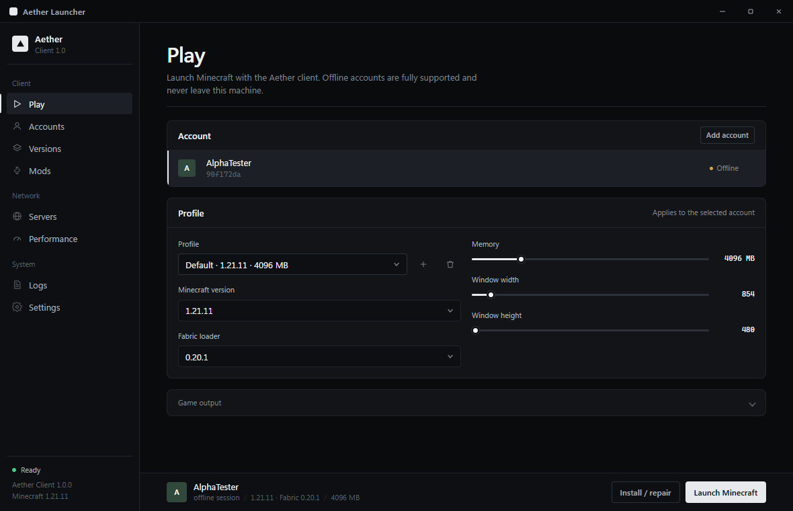
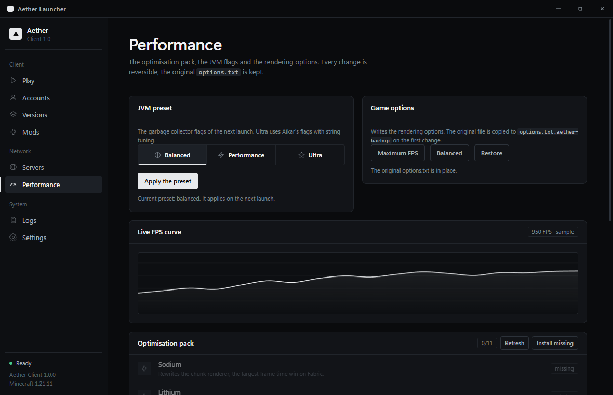
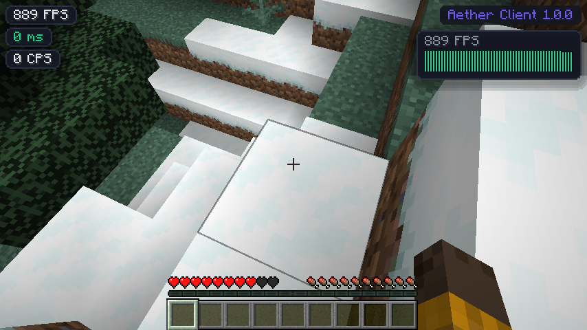

# Aether Client

A Minecraft client in the spirit of **Lunar Client**, **Badlion** and **Feather**, built on
**Fabric**, with first-class **offline (cracked) mode** support.

It consists of two parts:

| Part | Path | Description |
| --- | --- | --- |
| **Aether Client** | `aether-client/` | Fabric mod that runs inside Minecraft: modules, HUD, Click GUI, configuration and session handling. |
| **Aether Launcher** | `launcher/` | Rust game-management core + Tauri 2 native desktop shell, with a shared interface for accounts, profiles, installs, mods, servers and performance. |

```
.
├── aether-client/      Fabric mod (Minecraft 1.21.11, Java 21, Mojang mappings)
├── launcher/           Rust core + Tauri 2 desktop shell
├── docs/               Architecture, features and verification notes
└── tools/              Local helper scripts/references used during development
```

| Play | Servers | Performance |
| --- | --- | --- |
|  |  |  |

In game, with the optimisation pack and an offline account on a hosted server:



## Offline mode

The launcher can start Minecraft without contacting Mojang when an **offline account** is used.

Minecraft derives the identity of an offline player from the username with:

```java
UUID.nameUUIDFromBytes(("OfflinePlayer:" + name).getBytes(StandardCharsets.UTF_8))
```

`net.minecraft.client.main.Main` does this when no explicit `--uuid` is provided. The launcher
passes the same deterministic identifier explicitly and starts the game with:

```text
--username <name>
--uuid <deterministic offline uuid>
--accessToken 0
```

- The placeholder token is not sent to Mojang by the launcher.
- Servers running with `online-mode=false` accept the session, singleplayer works normally, and the
  player keeps the same identity for the same username.
- In-game, the mod detects offline sessions and reflects that in the UI/session information (and
  disables online-only flows such as Realms where applicable).

The UUID logic is implemented and tested in:
- `launcher/src/offline.rs` (Rust)
- `aether-client/src/test/java/dev/aether/client/OfflineSessionTest.java` (Java)

Reference examples:

```text
Notch        b50ad385-829d-3141-a216-7e7d7539ba7f
Steve        5627dd98-e6be-3c21-b8a8-e92344183641
Player123    3da1e349-17b0-38ed-a07b-1e78c8ebd956
```

## Offline servers

The **Servers** page of the launcher answers one question before the game starts: *will this server
accept an offline account?* Two real network exchanges are used, no guessing:

1. **Server List Ping** (`servers ping`) reads the MOTD, the player counts, the protocol and the
   latency.
2. **Login probe** (`servers probe`) opens the login handshake, sends `Login Start` with the name the
   player would use, and reads the first answer of the server:
   - `0x01 Encryption Request` → the server is in `online-mode=true`, a Microsoft account is needed;
   - `0x02 Login Success` / `0x03 Set Compression` → the server accepts the name as it is;
   - `0x00 Disconnect` → the server refused, with its own reason.

```powershell
aether-launcher servers add Hypixel mc.hypixel.net
aether-launcher servers ping mc.hypixel.net
aether-launcher servers probe mc.hypixel.net
```

The **host** part of the page starts a local Fabric server with `online-mode=false` in one click (the
Fabric installer is downloaded once and shared by every hosted server), prints its address and lets
the player join it with the same button as any other server. Stopping it goes through RCON so the
world is saved before the process ends.

## Maximum FPS

The **Performance** page installs and verifies a pack of client-side optimisation mods from
Modrinth (Sodium, Lithium, FerriteCore, ImmediatelyFast, EntityCulling, MoreCulling, Krypton,
BadOptimizations, Dynamic FPS, Clumps and the Cloth Config library they depend on), then writes the
game options and the JVM flags.

| Preset | What it does |
| --- | --- |
| `performance tune --preset max` | Render distance 8, particles minimal, no clouds, no entity shadows, VSync off, 260 FPS cap, `graphicsPreset=custom` so the game keeps these values. |
| `performance tune --preset balanced` | The same idea with a normal-looking world (render distance 12, clouds on). |
| `performance tune --preset restore` | Puts the original `options.txt` back from the backup taken on the first tuning. |
| `performance jvm ultra` | G1 flags tuned for a client: larger young generation, no biased locking, `AlwaysPreTouch` off. |

The mod adds an **FPS Graph** HUD element (three seconds of history, green/orange/red bars) and the
launcher reports the frame rate reached in game — see
[`docs/images/fps-offline-hud.png`](docs/images/fps-offline-hud.png).

## Features

### Client (mod)
- **Interface**: Click GUI, configuration screen, HUD editor, custom main menu styling, `/aether` command.
- **HUD elements**: FPS, FPS Graph, Ping, CPS, Keystrokes, Armor, Potions, Coordinates, Server Brand, Held Item, Session Timer, Target HUD, Session.
- **Modules** (Render, Combat, Movement, Misc, HUD): e.g. Fullbright, FOV, No View Bobbing, Crosshair, Watermark, Auto Tool, Kill Aura, Auto Crystal, Anti Knockback, Auto Sprint, No Fall, Safe Walk, Auto Jump, Hide Scoreboard, Notifications.

See [`docs/FEATURES.md`](docs/FEATURES.md) for the detailed list.

### Launcher
- Offline and Microsoft account support.
- Version/Fabric loader selection and installation pipeline.
- Downloads/verifies game client, libraries, assets, Fabric profile dependencies, Fabric API and Aether mod jar.
- Builds and runs the Java launch command through the Rust CLI and native Tauri desktop shell.
- Servers page: server list, ping, offline-account probe, one-click hosting of an offline server.
- Performance page: optimisation pack from Modrinth, options and JVM presets.
- Stores settings/accounts/game data under an Aether-managed home (configurable).

## Prerequisites

### Aether Client (`aether-client/`)
- **JDK 21** for compiling/running Minecraft 1.21.11 (Gradle toolchain is configured for Java 21).
- **A JDK compatible with Gradle/Fabric Loom** to run Gradle itself (Loom 1.19 may require a newer JDK, e.g. 25, depending on your setup; `tools/setup.ps1` can help provision local tooling on Windows).

### Aether Launcher (`launcher/`)
- **Rust toolchain** (Cargo) to build/test the launcher core.
- **MSVC C++ Build Tools + WebView2** for the Tauri Windows desktop shell.
- **Node.js + npm** for development scripts and the optional Electron fallback.
- A working **Java runtime** for launching Minecraft (the launcher can detect/configure it).

## Building

### Fabric mod
```powershell
cd aether-client
# Use your installed Gradle, the Gradle wrapper if present, or the local toolchain in ../tools
gradle build
```

Outputs:
- `aether-client/build/libs/aether-client-1.0.0.jar`

### Launcher core (Rust)
```powershell
cd launcher
cargo build --release
```

Binary:
- `launcher/target/release/aether-launcher` (or `.exe` on Windows)

### Launcher desktop (Tauri 2 + Rust)
```powershell
cd launcher
cargo build --release
cargo run --manifest-path desktop/Cargo.toml
```

Convenience command (builds the Rust core before starting Tauri):
```powershell
cd launcher
npm start
```

Release installer (install the Tauri CLI once with `cargo install tauri-cli --version "^2"`):
```powershell
npm run build:desktop
npm run dist:desktop
```

The native shell embeds the Rust core and uses the system WebView2 runtime. The legacy Electron shell remains available with `npm run start:electron`, but is no longer the default.

## Command line (launcher core)

The Rust binary exposes JSON-oriented commands used by the GUI and usable directly:

```powershell
cd launcher
cargo run --release -- help
```

Examples:

```powershell
cargo run --release -- info
cargo run --release -- versions --limit 20
cargo run --release -- loaders --version 1.21.11
cargo run --release -- account add-offline Notch
cargo run --release -- accounts
cargo run --release -- install --version 1.21.11 --loader 0.20.1
cargo run --release -- command --account <account-id>
cargo run --release -- launch --account <account-id>
cargo run --release -- launch --server 127.0.0.1:25565
cargo run --release -- servers ping mc.hypixel.net
cargo run --release -- servers probe mc.hypixel.net
cargo run --release -- hosts create --name "Local Test" --port 25565 --players 10
cargo run --release -- hosts start "Local Test"
cargo run --release -- hosts stop "Local Test"
cargo run --release -- performance list
cargo run --release -- performance install
cargo run --release -- performance tune --preset max
cargo run --release -- performance jvm ultra
```

(You can also run the compiled binary from `target/release/` directly.)

## Data locations

By default the launcher resolves paths under the user's home directory:

| What | Default location |
| --- | --- |
| Launcher data (settings/accounts/logs) | `<home>/Aether/aether` |
| Game directory (assets/libraries/versions/mods) | `<home>/Aether/.minecraft` |

Environment overrides:
- `AETHER_HOME`: moves the launcher home/root.
- `AETHER_SHARED_DIR`: points the game directory to an existing `.minecraft`.
- `AETHER_MOD_JAR`: overrides the path to the Aether client mod jar used during installation.
- `AETHER_LAUNCHER_BIN` (GUI): path to the launcher core binary.

## Tests

### Launcher (Rust)
```powershell
cd launcher
cargo test --release      # 151 tests: 122 unit + 6 download + 20 integration + 3 sha1
cargo clippy --release --all-targets
```

### Client (Java / Gradle)
```powershell
cd aether-client
gradle build              # 25 JUnit tests, then the remapped jar
```

### Desktop and renderer regression checks
From `launcher/`, run the dependency-free Node.js checks before changing the main process or preload:

```powershell
node --check gui/src/main.cjs
node --check gui/src/preload.js
npm run test:security
```

The checks cover HTTPS-only external navigation, renderer IPC origin checks, and mutual exclusion
for installation/game operations.

### Interface (shared renderer, desktop runtime)
```powershell
# Starts the launcher on a debugging port, walks every page at 1180x760 and 940x620,
# measures the overflows and writes the screenshots.
node tools/ui-check.mjs 9231 tools/ui-shots
```

The behavioural end-to-end checks (failures, crash report, cancellation, timeouts, accessibility,
profiles, sliders) live in `tools/e2e/` and run through `npm run e2e:*` from `launcher/` — see
[`docs/VERIFICATION.md`](docs/VERIFICATION.md) §4.1 for the full procedure.

## Documentation

- [`docs/ARCHITECTURE.md`](docs/ARCHITECTURE.md) – component design and key decisions
- [`docs/FEATURES.md`](docs/FEATURES.md) – user-facing features and modules
- [`docs/VERIFICATION.md`](docs/VERIFICATION.md) – verification checklist and measured results
- [`RAPPORT-FINAL.md`](RAPPORT-FINAL.md) – analyse, tests, FPS, verdict on the interface and the
  advanced improvements (in French)

## Licence

MIT. Minecraft is a trademark of Mojang Studios; this project is not affiliated with Mojang or
Microsoft.
