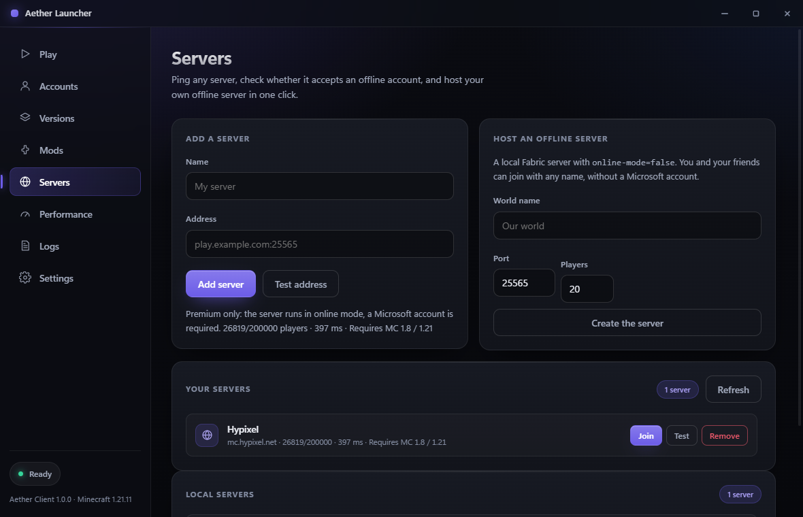

# Aether Client

> **MimiMax is the development repository of Aether.** The GitHub project and the root
> `MimiMax.exe` runner predate the product name; the code, the packages (`dev.aether.client`), the
> data folder (`~/Aether`) and the documentation use **Aether**.

A Minecraft client built on **Fabric**, with first-class **offline (cracked) mode** support and a
launcher that installs, tunes and starts the game.

It consists of two parts:

| Part | Path | Description |
| --- | --- | --- |
| **Aether Client** | `aether-client/` | Fabric mod that runs inside Minecraft: modules, HUD, Click GUI, configuration and session handling. |
| **Aether Launcher** | `launcher/` | Rust launcher core + native shell (Tauri/WebView2) that manages accounts/settings, installs Minecraft/Fabric/mods and starts the game. |

```
.
├── aether-client/      Fabric mod (Minecraft 1.21.11, Java 21, Mojang mappings)
├── launcher/           Rust core (src/) + native shell (desktop/) + its interface (gui/src/ui/)
├── docs/               Architecture, features and verification notes
└── tools/              Local helper scripts/references used during development
```

| Play | Servers | Performance |
| --- | --- | --- |
|  |  |  |

In game, with the optimisation pack and an offline account on a hosted server:


*Measured on 854×480, render distance 8, RTX 4060 Ti / Ryzen 7 5700X, empty local server. The frame
rate depends on the machine and on the scene: the Performance page reports what your own game
reaches, not this number.*

## What this client is, and what it is not

It is a client for **singleplayer, offline servers and private servers you run or are allowed to
join**: HUD elements, interface modules, movement helpers, an offline-first launcher, a local server
host, and a verified optimisation pack.

It is **not** marketed as an anti-cheat-safe client. The Combat category really does contain
Kill Aura, Auto Crystal and Anti Knockback (`docs/FEATURES.md`), and no module claims to be
undetectable, to bypass a specific anti-cheat, or to be allowed on servers that forbid it. Those
modules exist for the player's own worlds and for servers whose rules permit them. **Using them on a
server that forbids them can get the account banned**, and a ban is not a bug of the client.

Every combat module is **disabled by default** (`docs/FEATURES.md`): a new configuration starts with
them off, and enabling one is a deliberate action.

The launcher is the part with no asterisk: offline and Microsoft accounts, installation, servers,
hosting, logs and the performance pack stay usable whatever the player does in game.

## Offline mode

The launcher can start Minecraft without contacting Mojang when an **offline account** is used.

Minecraft derives the identity of an offline player from the username with:

```java
UUID.nameUUIDFromBytes(("OfflinePlayer:" + name).getBytes(StandardCharsets.UTF_8))
```

`net.minecraft.client.main.Main` does this when no explicit `--uuid` is provided. The launcher
passes the same deterministic identifier explicitly and starts the game with:

```text
--username <name>
--uuid <deterministic offline uuid>
--accessToken 0
```

- The placeholder token is not sent to Mojang by the launcher.
- Servers running with `online-mode=false` accept the session, singleplayer works normally, and the
  player keeps the same identity for the same username.
- In-game, the mod detects offline sessions and reflects that in the UI/session information (and
  disables online-only flows such as Realms where applicable).

### Joining a cracked server

A cracked server (JartexNetwork, and most `online-mode=false` servers) accepts an offline account, but
almost all of them **protect the names Mojang owns**: if the name is registered by a Mojang account,
the server refuses the connection and the game only shows `Unauthorized: You cannot join the server`.
No client can talk its way past that rule; the name has to change.

The launcher therefore asks Mojang before the game starts
(`https://api.mojang.com/users/profiles/minecraft/<name>`, `200` = owned by a Mojang account,
`204`/`404` = free):

```powershell
aether-launcher account check Notch
# {"name":"Notch","ok":true,"premium":true}        -> refused by cracked servers

aether-launcher account check Notch9281
# {"name":"Notch9281","ok":true,"premium":false}  -> accepted everywhere
```

The interface uses the same answer in two places: an amber warning appears under the name field while
an offline account is typed, and joining a public server with a premium name opens a dialog that says
why and offers either `Choose another name` or `Join anyway`. Local and loopback addresses are never
blocked, and a lookup that fails (no network, rate limit) never prevents a launch: the game stays the
judge.

This is not a workaround of `online-mode=true`. It is the opposite: the launcher refuses to let the
player believe a name is usable when the server will reject it.

The UUID logic is implemented and tested in:
- `launcher/src/offline.rs` (Rust)
- `aether-client/src/test/java/dev/aether/client/OfflineSessionTest.java` (Java)

Reference examples:

```text
Notch        b50ad385-829d-3141-a216-7e7d7539ba7f
Steve        5627dd98-e6be-3c21-b8a8-e92344183641
Player123    3da1e349-17b0-38ed-a07b-1e78c8ebd956
```

## Microsoft account security

On Windows, Microsoft access and refresh tokens are **not stored in accounts.json** and are not
returned to the interface through the account JSON contract. They are stored in accounts.credentials,
protected with Windows DPAPI for the current Windows user. Copying that file to another Windows
account does not grant access to the session tokens.

Existing installations are migrated on first start: the launcher encrypts the legacy tokens first,
then rewrites the public account catalogue without them. If the protected vault cannot be decrypted
(for example, after moving it to another Windows user profile), account metadata is kept but the
Microsoft account must be signed in again. The diagnostic command also redacts the access token from
its displayed launch arguments.

The protected Microsoft session vault is currently supported by the Windows launcher. Non-Windows
builds refuse to persist new Microsoft session secrets rather than silently writing them in clear
text; offline accounts remain available.

## Launcher security and process integrity

The launcher treats downloaded metadata and files as untrusted input:

- Minecraft/Fabric identifiers, library-relative paths, asset hashes, hosted-server version names and
  Modrinth JAR filenames are validated before they are used in local file paths.
- ZIP extraction rejects archive entries that escape the destination; duplicate content-addressed
  assets are deduplicated before parallel download workers start.
- Mod and session-log operations reject symbolic links rather than following paths outside the
  launcher's managed folders.
- Atomic writes use unique temporary siblings. The native shell applies the same rule when extracting
  its embedded core and client JAR, then replaces completed files atomically.
- The Tauri WebView has an injected Content Security Policy that disables plugins/objects and
  restricts scripts, base URLs and form submissions to the local application. JavaScript built-in
  prototypes are frozen.
- The shell refuses a second simultaneous installation or Minecraft launch, preserving the process
  handle that the Stop/Cancel controls need.

On Windows, the CI workflow builds the embedded Fabric JAR with Java 25 (required by the current
Gradle/Loom runtime) while retaining the mod's Java 21 compilation target, then builds the Rust core
and native Tauri shell.

## Offline servers

The **Servers** page of the launcher answers one question before the game starts: *will this server
accept an offline account?* Two real network exchanges are used, no guessing:

1. **Server List Ping** (`servers ping`) reads the MOTD, the player counts, the protocol and the
   latency.
2. **Login probe** (`servers probe`) opens the login handshake, sends `Login Start` with the name the
   player would use, and reads the first answer of the server:
   - `0x01 Encryption Request` → the server is in `online-mode=true`, a Microsoft account is needed;
   - `0x02 Login Success` / `0x03 Set Compression` → the server accepts the name as it is;
   - `0x00 Disconnect` → the server refused, with its own reason.

```powershell
aether-launcher servers add Hypixel mc.hypixel.net
aether-launcher servers ping mc.hypixel.net
aether-launcher servers probe mc.hypixel.net
```

The **host** part of the page starts a local Fabric server with `online-mode=false` in one click (the
Fabric installer is downloaded once and shared by every hosted server), prints its address and lets
the player join it with the same button as any other server. Stopping it goes through RCON so the
world is saved before the process ends.

An offline server accepts any name, so the generated `server.properties` never relies on that:

- `server-ip=127.0.0.1` keeps it on the loopback interface, and RCON travels in clear text on the
  same interface;
- `white-list=true` and `enforce-whitelist=true` are always written, and `whitelist.json` is seeded
  with every account of the launcher (a world created before the first account is whitelisted at
  its first start), so a stranger who reaches the port cannot take the operator's name;
- the RCON password is 32 random hexadecimal characters, written only in `server.properties` and
  never shown in clear text or in the server metadata.

Opening the server to the local network is not a one-click action: it requires editing
`server.properties` on purpose, and the whitelist is already in place when you do.

## Maximum FPS

The **Performance** page installs and verifies a pack of client-side optimisation mods from
Modrinth (Sodium, Lithium, FerriteCore, ImmediatelyFast, EntityCulling, MoreCulling, Krypton,
BadOptimizations, Dynamic FPS, Clumps and the Cloth Config library they depend on), then writes the
game options and the JVM flags.

| Preset | What it does |
| --- | --- |
| `performance tune --preset max` | Render distance 8, particles minimal, no clouds, no entity shadows, VSync off, 260 FPS cap, `graphicsPreset=custom` so the game keeps these values. |
| `performance tune --preset balanced` | The same idea with a normal-looking world (render distance 12, clouds on). |
| `performance tune --preset restore` | Puts the original `options.txt` back from the backup taken on the first tuning. |
| `performance jvm ultra` | G1 flags tuned for a client: larger young generation, no biased locking, `AlwaysPreTouch` off. |

The mod adds an **FPS Graph** HUD element (three seconds of history, green/orange/red bars) and the
launcher reports the frame rate reached in game — see
[`docs/images/fps-offline-hud.png`](docs/images/fps-offline-hud.png).

## Features

### Client (mod)
- **Interface**: Click GUI, configuration screen, HUD editor, custom main menu styling, `/aether` command.
- **HUD elements**: FPS, FPS Graph, Ping, CPS, Keystrokes, Armor, Potions, Coordinates, Server Brand, Held Item, Session Timer, Target HUD, Session.
- **Modules** (Render, Combat, Movement, Misc, HUD): e.g. Fullbright, FOV, No View Bobbing, Crosshair, Watermark, Auto Tool, Kill Aura, Auto Crystal, Anti Knockback, Auto Sprint, No Fall, Safe Walk, Auto Jump, Hide Scoreboard, Notifications.

See [`docs/FEATURES.md`](docs/FEATURES.md) for the detailed list.

### Launcher
- Offline and Microsoft account support.
- Version/Fabric loader selection and installation pipeline.
- Downloads/verifies game client, libraries, assets, Fabric profile dependencies, Fabric API and Aether mod jar.
- Builds and runs the Java launch command (CLI) or launches from the native shell.
- Servers page: server list, ping, offline-account probe, one-click hosting of an offline server.
- Premium-name guard: `account check` asks Mojang whether a name belongs to a Mojang account, and the
  interface warns before a cracked server can reject the connection.
- Performance page: optimisation pack from Modrinth, options and JVM presets.
- Identity Studio: four designed material colourways, live preview, custom accent, topographic/drafting
  surfaces, compact or roomy spacing and expanded or icon-rail navigation. Preferences are local and
  survive restarts.
- Records the process of the game, so a game left behind by a closed launcher can still be stopped
  (`aether-launcher stop`, or the Stop button of the next session).
- Stores settings/accounts/game data under an Aether-managed home (configurable).

## Prerequisites

### Aether Client (`aether-client/`)
- **JDK 21** for compiling/running Minecraft 1.21.11 (Gradle toolchain is configured for Java 21).
- **A JDK compatible with Gradle/Fabric Loom** to run Gradle itself (Loom 1.19 may require a newer JDK, e.g. 25, depending on your setup; `tools/setup.ps1` can help provision local tooling on Windows).

### Aether Launcher (`launcher/`)
- **Rust toolchain** (Cargo) to build/test the launcher core and the shell.
- **WebView2** to run the shell: Windows 10/11 ship it, and the NSIS installer carries the
  bootstrapper for machines that do not.
- A working **Java runtime** for launching Minecraft (the launcher can detect/configure it).
- Node.js is only needed for the end-to-end scripts in `tools/e2e/` (`node --test`, CDP over
  WebSocket); the launcher itself has no npm dependency.

## Building

### Fabric mod
```powershell
cd aether-client
# Use your installed Gradle, the Gradle wrapper if present, or the local toolchain in ../tools
gradle build
```

Outputs:
- `aether-client/build/libs/aether-client-1.0.0.jar`

### Launcher core (Rust)
```powershell
cd launcher
cargo build --release
```

Binary:
- `launcher/target/release/aether-launcher` (or `.exe` on Windows)

### Launcher shell (Tauri)
```powershell
cd launcher
cargo build --release --manifest-path desktop/Cargo.toml
# or, from the same folder: npm run shell
```

Binary:
- `launcher/desktop/target/release/aether-desktop.exe` (~8.75 MB, the core, the mod and the interface are embedded)

The shell embeds the core binary at compile time, so the core is always built first:
`npm run core && npm run shell`. `npm start` runs the shell from the build directory.

The root `MimiMax.exe` / `Aether-Launcher.exe` (`tools/launcher-runner.rs`) only looks for the shell
and starts it; `build.bat` compiles the core, the shell, the mod and that runner in order.

### Installer
```powershell
cd launcher/desktop
cargo tauri build      # NSIS (French) + portable executable
```
The artefacts land in `launcher/desktop/target/release/bundle/`; `dist/` keeps the two files that
were published (`Aether-Launcher-1.0.0-portable.exe`, `Aether-Launcher-Setup-1.0.0.exe`).

## Command line (launcher core)

The Rust binary exposes JSON-oriented commands used by the interface and usable directly:

```powershell
cd launcher
cargo run --release -- help
```

Examples:

```powershell
cargo run --release -- info
cargo run --release -- versions --limit 20
cargo run --release -- loaders --version 1.21.11
cargo run --release -- account add-offline Notch
cargo run --release -- account check Notch
cargo run --release -- accounts
cargo run --release -- install --version 1.21.11 --loader 0.20.1
cargo run --release -- verify
cargo run --release -- verify --repair
cargo run --release -- install --discard
cargo run --release -- command --account <account-id>
cargo run --release -- launch --account <account-id>
cargo run --release -- launch --server 127.0.0.1:25565
cargo run --release -- stop
cargo run --release -- servers ping mc.hypixel.net
cargo run --release -- servers probe mc.hypixel.net
cargo run --release -- hosts create --name "Local Test" --port 25565 --players 10
cargo run --release -- hosts start "Local Test"
cargo run --release -- hosts stop "Local Test"
cargo run --release -- performance list
cargo run --release -- performance install
cargo run --release -- performance tune --preset max
cargo run --release -- performance jvm ultra
```

(You can also run the compiled binary from `target/release/` directly.)

`stop` reads the record of the game written by the last launch, so it also stops a game whose
launcher was closed or killed; it answers `{"ok": false, "error": "no game is running"}` when there
is nothing to close.

`verify` recomputes the digest of every file an installation declares and answers with the files
that are missing or altered; `--repair` re-downloads only those. `install --discard` closes an
interrupted installation: it removes the journal and the partial downloads.

## Verified, resumable installation

- **Nothing is moved into place before its digest matches.** A download is hashed while it is
  written, to `<file>.part`, and renamed only once the SHA-1 that Modrinth or Mojang publishes
  matches. A corrupt body is discarded and fetched again; a failed download never replaces the
  previous file.
- **`verify` checks what is really on the disk.** The client jar, every library, the asset index,
  every asset (named by its own digest) and the jars of the optimisation pack are hashed and
  compared to their published digest. `verify --repair` fetches only the files that differ, from
  the address their metadata gives.
- **An interrupted installation is resumable.** `install` and `performance install` write
  `install.pending.json` before the first request, advance it at every step and delete it at the
  end. A cancelled or crashed run leaves it behind; the next run of the same command skips every
  file whose digest already matches and fetches the rest. `info` reports it as `pendingInstall`,
  and `install --discard` removes the journal with the leftover `.part` files.
- **The optimisation pack is resolved as a graph before the first download.** The required
  dependencies of Modrinth are read from the API, a dependency that pins a `version_id` is installed
  at that exact version with the SHA-1 of that version, a project is downloaded once even when the
  pack lists it and another mod requires it (Cloth Config for MoreCulling and Dynamic FPS), and an
  incomplete graph stops the installation while nothing has been written — a pack missing a library
  its mods need would not start. Optional, embedded and incompatible declarations are named in the
  installation report instead of being silently ignored, two different pinned versions of one
  project are reported as a conflict, and a build that does not announce the pack's Minecraft
  version or Fabric is refused before any download.

## Data locations

By default the launcher resolves paths under the user's home directory:

| What | Default location |
| --- | --- |
| Launcher data (settings/accounts/logs) | `<home>/Aether/aether` |
| Record of the running game | `<home>/Aether/aether/game.pid` |
| Journal of an unfinished installation | `<home>/Aether/aether/install.pending.json` |
| Game directory (assets/libraries/versions/mods) | `<home>/Aether/.minecraft` |

Environment overrides:
- `AETHER_HOME`: moves the launcher home/root.
- `AETHER_SHARED_DIR`: points the game directory to an existing `.minecraft`.
- `AETHER_MOD_JAR`: overrides the path to the Aether client mod jar used during installation.
- `AETHER_LAUNCHER_BIN` (shell): path to the launcher core binary.

## Tests

### Launcher (Rust)
```powershell
cd launcher
cargo test --release
cargo clippy --release --all-targets
```

The 163-test count above is the previously measured baseline (134 unit, 6 download, 20 integration
and 3 SHA-1 tests). This hardening branch adds further regression coverage for DPAPI secret wiping,
archive/path traversal, duplicate asset downloads, symlink rejection, concurrent embedded-resource
writes and single-flight install/game process handling. CI is the source of truth for the current
branch revision.

### Launcher shell (Rust)
```powershell
cd launcher
cargo test --release --manifest-path desktop/Cargo.toml
```

8 tests, including the embedded mod: that it is a real jar, and that its extraction replaces an older
archive without leaving a temporary file behind. `tools/checks/clean-install-check.ps1` proves the rest on a
clean machine (see `launcher/desktop/README.md`).

### Design tokens
```powershell
node tools/checks/check-theme-tokens.mjs
```

Fails when a `var(--…)` of the interface has no definition in `launcher/gui/src/ui/tokens.css`, or
when the same token is declared in two files. `tools/window/capture-window.ps1` screenshots the real window
and `tools/checks/theme-probe.mjs` reads the computed theme over the DevTools protocol of WebView2.
`tools/checks/theme-sweep.mjs` walks the eight pages, exercises the accent control by clicking it, and
audits every page: unresolved tokens, text below the WCAG contrast floor, leftovers of the previous
palette. Start the shell with `WEBVIEW2_ADDITIONAL_BROWSER_ARGUMENTS="--remote-debugging-port=9247"`,
then `node tools/checks/theme-sweep.mjs 9247 tools/theme-pages` (optionally a colour as a fourth argument).
With `AETHER_INSTALL_STATE=1` it also measures the interface during an installation, the only state
that renders a `.btn--danger` (and it hovers it, where the danger colour is filled): start the shell
on the fake core with `AETHER_FAKE_FAIL=install-slow`, then add `--install-only` to measure just that
state. `AETHER_INSTALL_STATE=legacy` forces the pre-fix danger fill back, which is how the audit is
proved to catch it (2,77:1).

`tools/e2e/play-fold.mjs` measures the action row of the Play page in the real 760 px window, where
the primary action has to be clickable without scrolling: it exits non-zero when `#btn-install` or
`#btn-cancel-install` crosses the bottom of the window, when the scroll zone above it is too short
or cannot reach its content, and when the page itself still scrolls. `--install` starts an
installation on the fake core first, so the cancel row is measured as well; `--json <path>` keeps
the geometry, `--size 980x700` overrides the layout viewport, `--shot <path>` captures the measured
state.

### Client (Java / Gradle)
```powershell
cd aether-client
gradle build
```

### Interface (headless check)
The interface is plain HTML/CSS/JS served by the shell; the checks drive it over the DevTools
protocol of WebView2, on an isolated `AETHER_HOME`:

```powershell
$env:AETHER_HOME = "tools/ui-home"
$env:AETHER_SHARED_DIR = "tools/aether-home/.minecraft"
$env:WEBVIEW2_ADDITIONAL_BROWSER_ARGUMENTS = "--remote-debugging-port=9233"
& launcher/desktop/target/release/aether-desktop.exe
node tools/checks/ui-check.mjs 9233 tools/ui-shots
```

The behavioural end-to-end checks (failures, crash report, cancellation, timeouts, accessibility,
profiles, sliders) live in `tools/e2e/` and run through `npm run e2e:*` from `launcher/` — see
[`docs/VERIFICATION.md`](docs/VERIFICATION.md) §4.2 for the full procedure.
`powershell -NoProfile -File tools/e2e/replay.ps1` replays all of them in one go: it starts one
window per scenario with the core mode that scenario needs, seeds the home its checks expect (an
offline account, mods, a finished session), and prints every `PASS`/`FAIL` with the exit code of the
check. Every check starts with `tools/e2e/guard.mjs`, which refuses to run unless `AETHER_HOME` is a
home under `tools/`: this walk deletes accounts, mods and profiles, so it must never meet the profile
of the person running it (`AETHER_E2E_ALLOW_ANY_HOME=1` overrides it on a disposable machine).

The eight scripts that click or drag go through `tools/e2e/click.mjs`: the target is scrolled to
the middle of the page and
the point is checked with `document.elementFromPoint` before any mouse event is sent, so a click that
would land on a toast, a dialog or a hidden layer fails at once with the name of what is in the way
instead of waiting for the 30 s timeout. `tools/e2e/hit.mjs` proves both directions (a covered button
is refused in milliseconds without sending anything, a hit on a child counts as the target), and
`node --test tools/e2e/click.test.mjs` keeps every press on that path.

## Documentation

- [`docs/ARCHITECTURE.md`](docs/ARCHITECTURE.md) – component design and key decisions
- [`docs/FEATURES.md`](docs/FEATURES.md) – user-facing features and modules
- [`docs/DESIGN-SYSTEM.md`](docs/DESIGN-SYSTEM.md) – palette, type scale and layout rules
- [`docs/VERIFICATION.md`](docs/VERIFICATION.md) – verification checklist and measured results
- [`SECURITY.md`](SECURITY.md) – how to report a vulnerability in private
- [`CONTRIBUTING.md`](CONTRIBUTING.md) – prerequisites, checks and style
- [`CHANGELOG.md`](CHANGELOG.md) – what changed, release by release
- [`THIRD-PARTY-NOTICES.md`](THIRD-PARTY-NOTICES.md) – the mods the optimisation pack installs
- [`launcher/desktop/README.md`](launcher/desktop/README.md) – Tauri build, installer and CDP recipe
- [`docs/rapports/ANALYSE-AMELIORATIONS.md`](docs/rapports/ANALYSE-AMELIORATIONS.md) – the improvement
  log, with the evidence of each change (in French)
- [`docs/rapports/RAPPORT-FINAL.md`](docs/rapports/RAPPORT-FINAL.md) – final specification and results
  (in French)
- [`docs/rapports/NETTOYAGE.md`](docs/rapports/NETTOYAGE.md) – repository layout and cleanup log (in
  French)

## Licence

MIT. Minecraft is a trademark of Mojang Studios; this project is not affiliated with Mojang or
Microsoft.
