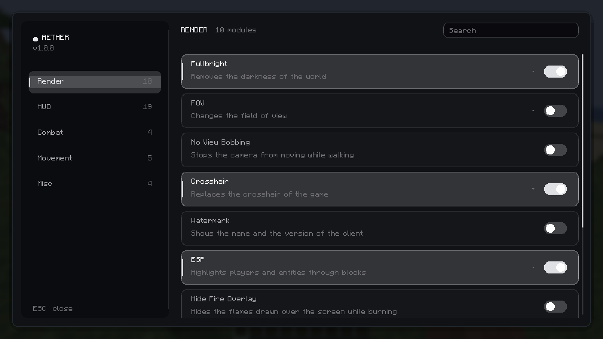
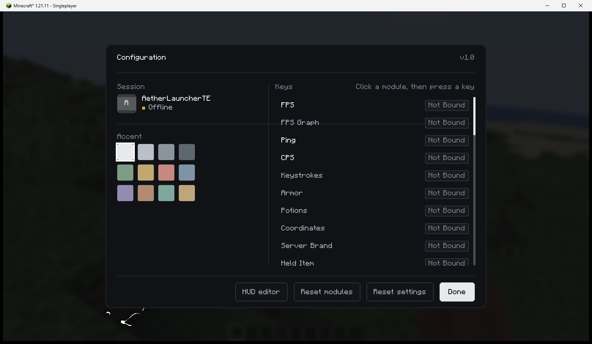
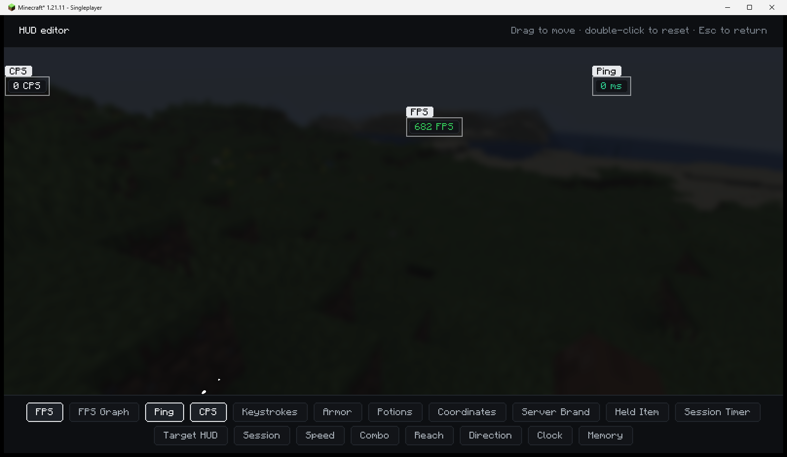

# Aether Client

The Fabric mod of the **Aether Client**. It adds the interface, the modules and the HUD of a
professional Minecraft client to the game.



|  |  |
| --- | --- |
| Configuration: session, accent and module keys | HUD editor: drag to move, double-click to reset |

## Requirements

| | |
| --- | --- |
| Minecraft | 1.21.11 |
| Loader | Fabric 0.20.1 |
| Fabric API | 0.141.6+1.21.11 |
| Java | 21 |
| Mappings | the official Mojang mappings |

## Building

Gradle itself needs a **JDK 25** (Fabric Loom 1.19 requires it), the game is compiled and started
with **Java 21**. The toolchain is installed by `../tools/setup.ps1`, the Java runtime for the game
is downloaded automatically by Gradle.

```powershell
..\tools\gradle-9.8.2\bin\gradle.bat build
```

The result is `build/libs/aether-client-1.0.0.jar`, a mod that can be dropped into the `mods`
folder of any Fabric installation.

```powershell
..\tools\gradle-9.8.2\bin\gradle.bat runClient
```

## The features

| Category | Modules |
| --- | --- |
| HUD | FPS, FPS Graph, Ping, CPS, Keystrokes, Armor, Potions, Coordinates, Server Brand, Held Item, Session Timer, Target HUD, Target Info, Speed, Combo, Reach, Direction, Clock, Session, Memory |
| Render | Fullbright, FOV, No View Bobbing, Crosshair, Watermark |
| Combat | Auto Tool, Kill Aura, Auto Crystal, Anti Knockback |
| Movement | Auto Sprint, No Fall, Safe Walk, Auto Jump |
| Misc | Hide Scoreboard, Notifications |

The click GUI opens with `RIGHT SHIFT`, on the main menu as well as in game.

A rail of categories on the left, the modules of the selected category as rows on the right: name,
description, keybind chip and animated switch. A click on a row toggles the module, the chevron
unfolds its settings, the chip rebinds the key and the field at the top filters the list. One layout
function returns every rectangle of the screen, and both the paint and the input read it, so a
control is never drawn somewhere it cannot be clicked. A narrow window shrinks the rail before the
list, and the list before the descriptions.

## The structure

```
src/main/java/dev/aether/client
├── AetherClient.java      the entry point
├── Aether.java            the singleton with the state
├── config/                the persistent configuration
├── module/                the module framework and the modules
├── setting/               the typed settings
├── hud/                   the HUD manager
├── gui/                   the click GUI, the configuration screen, the HUD editor
├── util/                  rendering, colours, animations, the click tracker, the session
└── mixin/                 the six places where the game has to be adapted
```

The details are in [`../docs/ARCHITECTURE.md`](../docs/ARCHITECTURE.md).

## The tests

```powershell
..\tools\gradle-9.8.2\bin\gradle.bat test
```

87 tests cover the offline identifier, the configuration, the helpers, the animations, the language
file, the knockback reduction and the mixins. The mixin tests read the class files with ASM and verify that every mixin exists,
that it patches a class of the game and that every injection point still exists with a matching
callback type. `LangCoverageTest` rebuilds the key of every module the way `Module.createKeyBinding`
does and fails when `assets/aether/lang/en_us.json` lacks one.

## The animation

Every moving value of the interface goes through `util/Animation`, an exponential decay that gives
the same motion at 30 and at 240 frames per second (two half frames land where one whole frame
does). The HUD elements that fade (target cards), flash (damage) or glide (speed, reach, combo)
read it on the frame clock, and so does the sliding indicator of the click GUI.

The switch of each row is advanced by the click GUI itself, on the same frame clock. It used to be
stepped from the client tick with a fixed 50 ms delta — twenty times per second while the screen
painted sixty or more, which is what a steppy animation looks like, and it froze as soon as the
screen was closed.

## Module keys

A mixin reads a module by key, while the module is registered under the lower case form of its name.
`module/ModuleKeys` holds the six keys mixins use, and `module/ModuleCatalog` holds the module list
without repeating any key. `ModuleCatalogTest` registers the real catalogue in a real `ModuleManager`
and asks it for every key: a rename on either side fails the build instead of leaving the hook
silently dead. It already caught one drift — `ComboCounter` is named « Combo » but was registered
under « combo counter » — which is exactly the class of bug the constants are there to prevent.

## The modules that were removed

A module that is listed, toggles and does nothing is worse than a missing one. `Tracers` drew a
2×2 point at the centre of the screen instead of a line, `Motion Blur` only had a setting, and
`Blink` counted ticks without ever holding a packet: all three are gone, with their registration
and their language keys. `HudModules.TargetInfo` was a complete target card that nothing ever
registered, so it is gone too.

## Hide Fire Overlay and Hide Hurt Overlay

Both are real now, and both were missing from the registration before.

`ScreenEffectRendererMixin` cancels `ScreenEffectRenderer#renderFire` at its head: only the flames
are skipped, the block and water overlays go through their own methods. Minecraft 1.21 draws no red
texture for a hit — the feedback is the camera tilt of `GameRenderer#bobHurt`, which
`GameRendererMixin` cancels while `Hide Hurt Overlay` is on. Writing into the vanilla
`damageTiltStrength` option was tried first and rejected: that option is saved in `options.txt`, so
the next launch would read the zero written by the module and restore zero for good.

The same trap applied to `Zoom`, which used to write the field of view into the options: the same
mixin divides the value returned by `GameRenderer#getFov` instead, so the option of the player is
never touched. `AutoTool` now only acts while the attack key is held (it used to swap the item in
hand as soon as the crosshair touched a block), and `AutoGG` is described as what it does — a message
on the death of the player, not at the end of a match.

## ESP

The glow of an entity is client state that nothing clears by itself, so the module remembers the ids
it tagged. `util/EspTargets` holds the two decisions without a Minecraft type: which entity is
selected (mode and range, a position that is not a number is refused) and which tagged entities a
new selection has to release. `EspTargetsTest` (6 tests) proves that an entity leaving the range is
released, that turning the module off releases everything it tagged, and that an entity that still
matches keeps its glow. The module also watches the `ClientLevel` it tagged the entities in: an id
is only unique inside one level, so a dimension change drops the set instead of releasing ids that
may now belong to unrelated entities.

## Keybinds

Every module can own a keybind, and the press is consumed by the client tick, outside a screen:
without that, the mapping appeared in the controls screen and in the click GUI and no key press
ever reached the module.

Every mapping is created and registered with Fabric while the client starts (`Module#createKeyBinding`),
because `KeyBindingRegistryImpl` throws once the options of the game exist: a keybind created from
the click GUI would have crashed the game. The interface therefore only moves the key of the existing
mapping (`KeyMapping#setKey`), and an unbound module shows no key chip.

## Anti knockback

The module is driven by `mixin/ClientPacketListenerMixin`, at the tail of `handleSetEntityMotion`:
that handler is where the client writes the velocity the server sends after a hit. It is the hook
that works from a client — vanilla `LivingEntity#knockback` is only called by `hurtServer`,
`doSweepAttack`, `causeExtraKnockback` and `blockedByItem`, all server-side, so a hook there would
never see the local player.

The arithmetic lives in `util/KnockbackReduction`, without a single Minecraft type: `AntiKnockbackTest`
(6 tests) and `KnockbackReductionTest` (11 tests) prove the reduction, the untouched delta when the
module is off, the default settings and the clamping of a hand-edited factor, without launching the
game.

The explosion push travels in its own packet and is handled apart, because it is **added** to the
velocity instead of replacing it: `handleExplosion` calls `player::addDeltaMovement`, so the delta at
the tail also carries the walk and the fall. The second injection reads `playerKnockback()` from the
packet, and `KnockbackReduction#applyToAdded` takes the vanilla push back out before adding the
reduced one. A push that is not finite is ignored, exactly as `Entity#addDeltaMovement` ignores it —
subtracting a vector vanilla never added would turn the motion into `NaN`.

The conditions that let the module act — the module enabled, a velocity packet naming the local
player, an explosion that actually carries a push — live in `util/KnockbackFilter`, again without a
Minecraft type, and `KnockbackFilterTest` (6 tests) proves them: another entity's packet, a disabled
module and a push-free explosion are all left alone.
